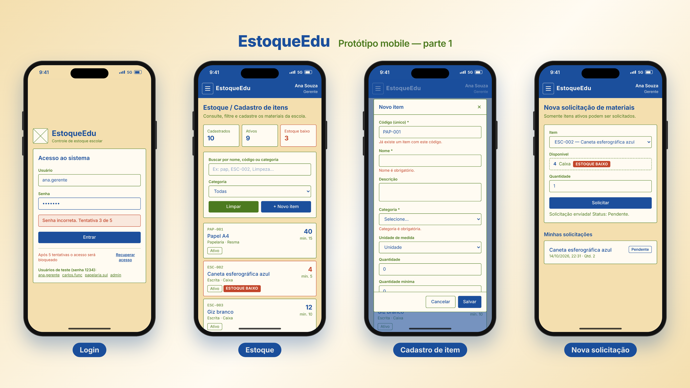
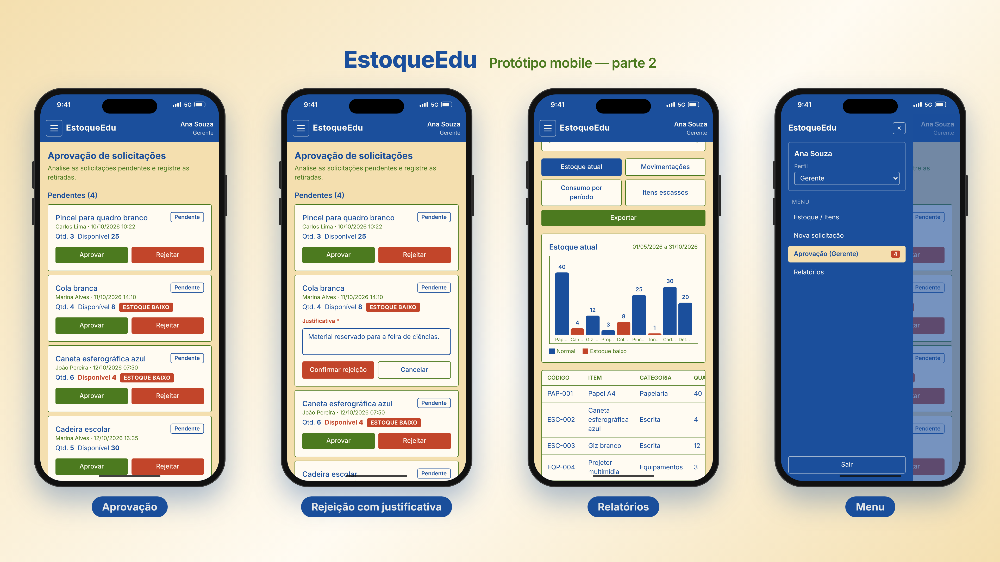

# EstoqueEdu

Protótipo de baixa fidelidade de um sistema de controle de estoque escolar, feito em React + Tailwind CSS.
É apenas figurativo: não há backend, API ou banco de dados. Todos os dados são mockados em `src/App.jsx`
e as ações (salvar, aprovar, rejeitar, solicitar, registrar retirada) alteram apenas o estado local.

## Como executar

```bash
npm install
npm run dev
```

## Acesso

Senha de todos os usuários de teste: `1234`

| Usuário        | Perfil        |
| -------------- | ------------- |
| ana.gerente    | Gerente       |
| carlos.func    | Funcionário   |
| papelaria.sul  | Fornecedor    |
| admin          | Administrador |

O seletor de perfil na barra superior permite simular outro perfil sem sair do sistema.

## Responsividade

O layout é responsivo:

- **Desktop (≥ 768px):** menu lateral fixo e tabelas completas.
- **Mobile (< 768px):** menu em gaveta aberto pelo botão ☰ da barra superior (com troca de perfil e "Sair"), tabelas convertidas em cards, botões em largura total e modal com rolagem.

## Telas e requisitos atendidos

| # | Tela | Requisitos atendidos |
| - | ---- | -------------------- |
| 1 | Login | RF07, RNF01, RNF03 |
| 2 | Estoque / Cadastro de itens | RF01, RF02, RF05, RF11, RN01, RN02, RN05, RN11 |
| 3 | Nova solicitação de materiais | RF06, RF08, RN06, RN08 |
| 4 | Aprovação de solicitações (Gerente) | RF03, RF09, RF10, RN03, RN09, RN10 |
| 5 | Relatórios | RF14, RN14 |

## Prints para apresentação

A pasta [`prints/`](prints) contém capturas da versão mobile dentro de uma moldura de celular:

- `visao-geral-1.png` e `visao-geral-2.png` — slides 16:9 (3840×2160) com 4 telas cada
- `01-login.png` … `08-menu.png` — cada tela individual, com fundo transparente



